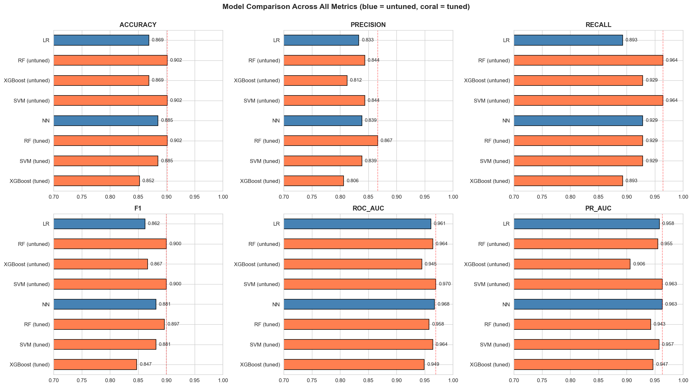
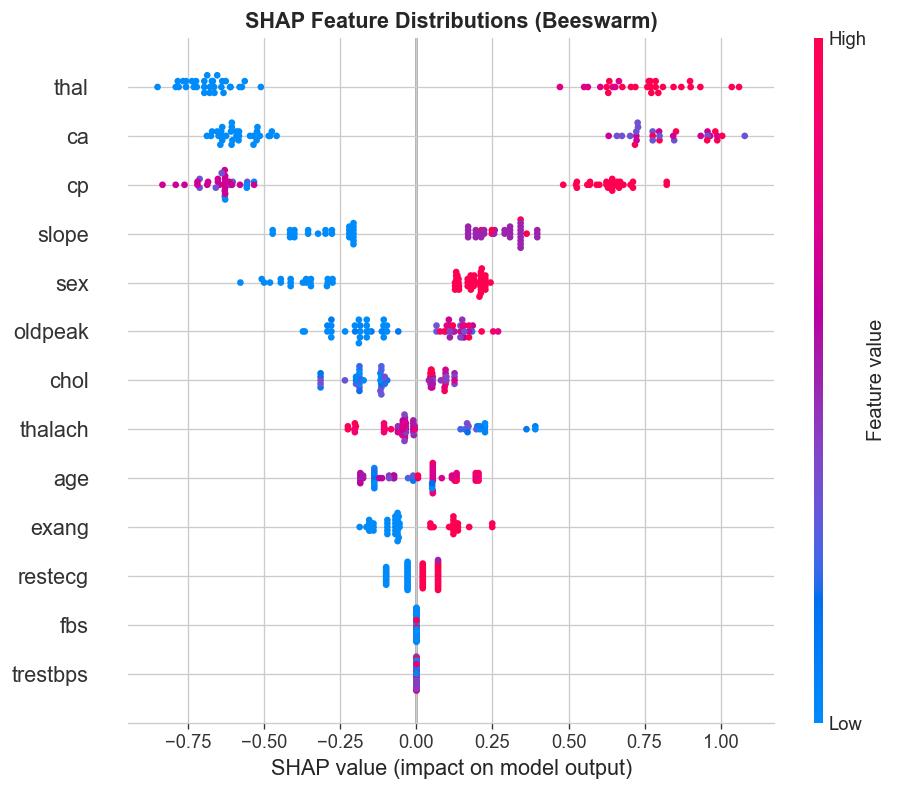
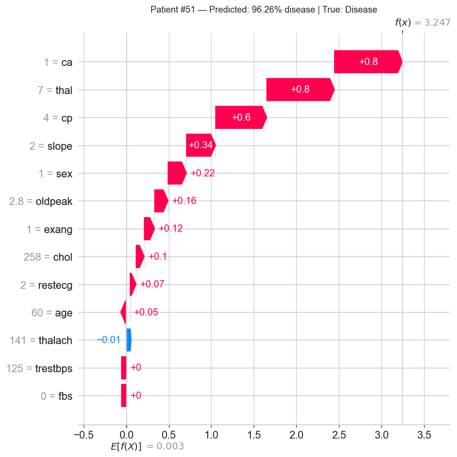
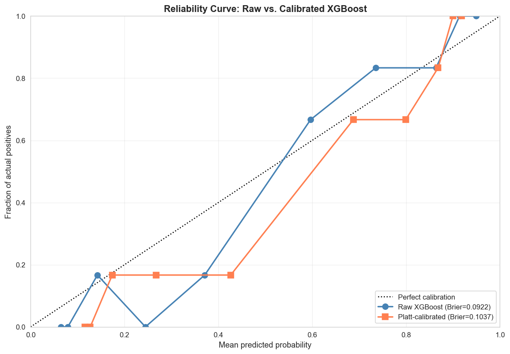

# Patient Risk Stratification Pipeline

[](https://github.com/Shrikant-Sharma/patient-risk-stratification/actions/workflows/tests.yml)
[](https://www.python.org)
[](https://xgboost.readthedocs.io)
[](LICENSE)

A machine learning project that predicts heart disease risk from 13 clinical inputs, explains each prediction, and serves it from an API with a data dictionary, a request log and a drift check. A second part estimates a causal effect and fits survival models on the NHEFS cohort.

It is a portfolio project on public research data. It is not a medical device and must not be used on real patients.

**Status, November 26, 2026.** Version 2 rebuilt the modeling half as scripts, corrected how the model is scored, and added monitoring. I ran every script and the 29 tests on my own Windows machine on November 26, 2026, and every number below is from that run ([results/RUN_SUMMARY.md](results/RUN_SUMMARY.md)). The same day I deployed the API on Render's free plan and pointed the AWS Lambda address of version 1 at version 2. Both passed the live check: 20 known patients, each within 0.0001 of the recorded score. Two decisions were mine to make, and I made one change of my own: see [DECISIONS.md](DECISIONS.md).

**Live API:** https://patient-risk-api.onrender.com/docs on Render (a free instance that sleeps when idle: the first request after a sleep took 27 seconds) and https://fcwkvdgi7lo2hp2xtfmyxzieia0xmfwr.lambda-url.us-east-1.on.aws/docs on AWS Lambda (first request after the update: 7 seconds). Both serve version 2 since November 26, 2026.

---

## Headline Results

### Predictive Modeling (UCI Heart Disease, 303 patients)

| Measure | Value | Measured on |
|---|---|---|
| AUC, nested cross-validation | 0.888 (folds from 0.809 to 0.928) | the 242 training patients, 15 outer folds |
| AUC, test | 0.957 (95% interval 0.899 to 0.995) | the 61 held-back patients, scored once |
| Recall at the served threshold | 0.92 (0.85 to 0.96) | out-of-fold scores for the 242 |
| Precision at the served threshold | 0.63 (0.55 to 0.70) | out-of-fold scores for the 242 |
| Test, at the served threshold | 27 of 28 with disease caught, 13 false alarms among 33 without | the 61, scored once |
| Brier score | 0.143 out-of-fold, 0.092 on the 61 | |

The number to quote is 0.888, from the project's seed. Over five training seeds it runs from 0.874 to 0.888, so 0.88 is the fair round number. With 61 patients the test set cannot separate 0.90 from 0.99, and 27 of 28 caught still leaves room for a true rate as low as 0.82.

The served threshold (0.222) comes from counting one missed patient as 3 false alarms. That ratio is my decision, and the reason is in [DECISIONS.md](DECISIONS.md), decision 1. At that threshold two of every three patients are flagged. Where the threshold lands is the least stable number here: when the 242 patients are resampled, the lowest-cost cut at 3 to 1 runs from 0.12 to 0.59, while recall at the served cut stays between 0.87 and 0.97.

Five model families were compared in the notebooks (logistic regression, random forest, XGBoost, SVM, a PyTorch network). Tuned XGBoost is the one that is served. Its three strongest inputs (`thal`, `ca`, `cp`) hold 61% of the mean absolute SHAP value, and they match what the exploratory analysis found.

### What version 2 corrected (November 2026)

| | Version 1 | Version 2 |
|---|---|---|
| Cross-validated AUC | 0.89, from a search run on data that SMOTE had already enlarged | 0.888, nested, with SMOTE fitted inside each training fold |
| Size of that leak | not measured | too small to measure: over five seeds the leaky search scored between 0.004 lower and 0.019 higher than the clean one. SMOTE added only 20 rows |
| Headline score | test AUC 0.95, on 61 patients | the cross-validated score, with the test score and its interval beside it |
| Threshold | 0.423, picked on the 61 test patients | 0.222, from a stated cost ratio, picked on out-of-fold scores |
| Recall and precision | 0.93 and 0.81, on the same 61 the threshold was picked on | 0.92 and 0.63 out-of-fold. Version 1's cut gives 0.83 and 0.72 there |
| Calibration | Platt scaling against the raw score, on the test set | raw, Platt and isotonic, each cross-fitted. The raw score is served |
| Causal refutation checks | run on DoWhy's default estimator (2.04 kg) | run on the estimator that gives the headline 3.27 kg |
| Starting the API from a fresh clone | failed: a pickled explainer was not in the repository | works: the trees and one JSON file |
| Inputs | any integer accepted for `thal` | only the codes in the data dictionary |
| Monitoring | none | request log, drift check, weekly check, retraining rules |

### NHEFS (causal inference and survival analysis)

| Module | Estimand | Headline |
|---|---|---|
| Causal inference: propensity score matching | Effect of quitting smoking on weight change, among quitters | **+3.27 kg** (95% interval 2.24 to 4.53, whole procedure resampled) |
| Causal inference: G-computation | Independent cross-check | **+3.47 kg** (95% CI 2.58, 4.44) |
| Causal inference: refutation checks | Placebo, random common cause, 80% subset, caliper width | Placebo falls to 0.00 kg. The others stay between 2.6 and 4.2 kg |
| Survival: Cox PH | Adjusted HR for cessation on 10-year mortality | **1.03** (95% CI 0.81, 1.32, p = 0.78) |
| Survival: Cox PH against a random survival forest | Test-set concordance | **0.802 / 0.804** |
| Survival: PH assumption | Schoenfeld residuals | All 10 covariates passed |

The unadjusted difference was +2.54 kg. After adjustment, matching gives +3.27 kg and G-computation +3.47 kg, beside the +3.4 to +3.5 kg that Hernán and Robins report with inverse probability weighting. My own weighting estimate, with the same propensity model as the matching, gives +3.34 kg. The unadjusted Kaplan-Meier comparison showed quitters with worse survival (log-rank p = 0.005), which the adjusted Cox model explains by age.

---

## Tech Stack

**Modeling:** Python 3.13, pandas, numpy, scikit-learn, XGBoost, imbalanced-learn (SMOTE), SHAP. In the notebooks also PyTorch and MLflow.

**Causal inference:** scikit-learn and scipy for the matching estimator and its checks, statsmodels, causaldata (NHEFS). In the notebook also DoWhy and NetworkX.

**Survival analysis (notebook):** lifelines, scikit-survival

**Serving:** FastAPI, Uvicorn, Pydantic. The API itself needs five packages (`requirements-api.txt`).

**Deployment files:** Render blueprint (`render.yaml`), Docker (multi-stage), AWS Lambda container image with Mangum

**Checks:** pytest on every push and a weekly live check, both in GitHub Actions

---

## Project Structure

```
patient-risk-stratification/
├── pipeline/
│   ├── 00_fetch_data.py                  Download the public file, check its fingerprint
│   ├── 01_evaluate.py                    Score three ways: the notebooks' way, SMOTE inside folds, no SMOTE
│   ├── 02_threshold_and_calibration.py   Calibration three ways, threshold from a cost ratio
│   ├── 03_train_final.py                 The served model and its metadata
│   ├── 04_causal_checks.py               Refutation checks on the headline estimator
│   ├── 05_drift_monitor.py               Replay patients, read the drift check, compare alert rules
│   ├── 06_live_check.py                  Check a running API from outside
│   └── common.py                         Data, split, model and search, shared
├── src/
│   ├── app.py                            FastAPI service
│   ├── schemas.py                        Request and response models
│   ├── data_dictionary.py                What each input means and the values it may take
│   └── monitoring.py                     Request log and drift check
├── models/                               xgb_v2.json, model_metadata.json, known_answers.json (and version 1's files)
├── results/                              What each pipeline step measured, as JSON
├── tests/test_api.py                     29 offline checks
├── notebooks/                            01 to 05: how the project was first built
├── reports/figures/                      Plots from the notebooks
├── .github/workflows/                    tests.yml (every push), weekly_check.yml (Mondays)
├── run_all.py                            Runs every step in order and keeps a log
├── decision.json                         The cost ratio that sets the threshold
├── DECISIONS.md                          My two decisions, my own change, and nineteen choices built in
├── MODEL_CARD.md                         Data, scores, limits, monitoring, retraining rules
├── render.yaml                           Render blueprint
├── Dockerfile, Dockerfile.lambda         Local image and Lambda image
├── requirements-api.txt                  The API's five packages, pinned
├── requirements-pipeline.txt             Pipeline and tests, pinned
└── requirements.txt                      The notebooks' full environment
```

The notebooks are kept as the record of how the project was first built. Their figures and the sections on SHAP, the causal estimate and survival below come from them. Where a notebook and a pipeline script disagree, the script is the corrected version, and the table above says what changed.

---

## Methodology

### 1. Exploratory Data Analysis
Dataset: UCI Heart Disease (Cleveland), 303 patients, 13 clinical features (plus binary target). Target reframed from 5-class severity to binary (disease vs. healthy) for clinical actionability. Distribution: 54% healthy / 46% disease. Demographic skew flagged (68% male) as a fairness concern requiring separate validation by sex before clinical use.

### 2. Preprocessing
Two preprocessing tracks were built in the notebooks, one for each model family:
- **Tree track** (Random Forest, XGBoost): raw features, no scaling, no one-hot encoding
- **Linear track** (Logistic Regression, SVM, NN): one-hot categoricals (with `drop_first`), StandardScaler on numerical features

The split is 80/20, stratified. Missing `ca` (4 rows) and `thal` (2 rows) are filled: the median for measurements, the most frequent code for coded inputs.

In version 1, SMOTE was applied to the training set once, after the split, and the hyperparameter search was then cross-validated on that enlarged set. The test set was clean, but inside the search a synthetic patient could sit in the training folds while the real patient it was built from was being scored. In version 2 the filling, SMOTE and the model are one pipeline (`pipeline/common.py`), so each is fitted on the training folds only.

### 3. Modeling
Five model families trained and logged to MLflow with hyperparameters, metrics, and artifacts:
- Logistic Regression (baseline)
- Random Forest
- XGBoost
- SVM (RBF kernel)
- PyTorch feedforward NN (3 layers, dropout, ReLU)

The top three (RF, SVM, XGBoost) were tuned with RandomizedSearchCV over 5 folds. XGBoost was chosen for serving on what serving it needs (exact SHAP values from the library itself, one model file). The families were not compared across seeds, so no family is claimed to beat another.

`pipeline/01_evaluate.py` then scores the XGBoost recipe three ways:

| Recipe | Cross-validated AUC | Test AUC (61 patients) |
|---|---|---|
| A. The notebooks' way: SMOTE once, then the search. The notebooks' folds | 0.887 (the search's best draw) | 0.950 |
| A. The same, on shuffled folds | 0.918 (the search's best draw) | 0.947 |
| B. SMOTE inside the folds | 0.899 (best draw), **0.888 nested** | 0.957 |
| C. No resampling | 0.899 (best draw), 0.875 nested | 0.949 |

The table is one seed. `pipeline/09_seed_check.py` trains both sides of each comparison again on five seeds (November 27, 2026), and three things follow. The leak was wrong in structure and too small to measure: the leaky search's best score was between 0.004 lower and 0.019 higher than the clean one, because SMOTE only added 20 rows to 242. A search's best draw flatters itself, so the number to quote is the nested one, where the whole search runs again inside each outer fold: 0.874 to 0.888 across the seeds. And SMOTE shows no gain that holds: its nested AUC was between 0.004 lower and 0.013 higher than no resampling, and the rule set before the numbers chose it on one seed of five, the project's own. The served model keeps SMOTE because that seed's rule chose it. With classes of 111 to 131 it hardly needed it, and I do not claim it helps.



### 4. Explainability: SHAP

SHAP TreeExplainer applied to the tuned XGBoost. Global feature importance and per-patient force plots generated.



The model independently rediscovered a counterintuitive clinical finding from EDA: patients reporting *asymptomatic* chest pain (cp=4) had the highest disease rates. This alignment between EDA and SHAP feature importance gave confidence the model was learning real clinical patterns rather than spurious noise.

Per-patient explanations available via the `/explain` API endpoint, enabling clinicians to verify any prediction:



### 5. Calibration and Threshold

Both choices are made on out-of-fold scores: each of the 242 training patients is scored by a model that never saw that patient. The 61 test patients are looked at once, at the end (`pipeline/02_threshold_and_calibration.py`).

**Calibration.** Three candidates, each cross-fitted so that no calibrator is scored on the patients it was fitted to:

| | Brier score, out-of-fold | Average gap between predicted and observed |
|---|---|---|
| Raw score | 0.143 | 0.049 |
| Platt scaling | 0.142 | 0.069 |
| Isotonic regression | 0.151 | 0.049 |

The rule was fixed first: the raw score is served unless a calibrator lowers the Brier score by more than chance. Neither did: Platt scaling was level with the raw score, isotonic regression was worse, and the 95% intervals of both differences include zero. So the raw score is served. The reliability curve from the notebooks:



**Threshold.** The threshold follows from one judgment: how many false alarms one missed patient is worth. The table is in [DECISIONS.md](DECISIONS.md), decision 1. At my ratio of 3 to 1 the threshold is 0.222: out-of-fold it catches 102 of 111 patients with disease and flags 60 of 131 without. Version 1 picked 0.423 on the test set and reported recall 0.93 on the same 61 patients. On out-of-fold scores that cut catches 92 of 111, a recall of 0.83. My own change (`pipeline/07_threshold_bootstrap.py`) resamples the 242 patients and shows how far each cut moves: the table is in DECISIONS.md.

### 6. Serving and Monitoring

The API (`src/app.py`) loads XGBoost's own model file and one JSON metadata file. Nothing is pickled, so a fresh clone starts.

| Endpoint | What it returns |
|---|---|
| `GET /health` | The service is up, and which model version is loaded |
| `POST /predict` | The probability, the flag at the served threshold, a risk tier |
| `POST /explain` | The same, with each input's SHAP contribution |
| `GET /data-dictionary` | What each input means, its unit, its allowed values, the range seen in training |
| `GET /model` | The recipe, the threshold, the measured scores, the library versions |
| `GET /monitoring/drift` | The drift check on the latest requests |

**Data dictionary.** `src/data_dictionary.py` is the one source for the meaning, unit and allowed values of each input. The request schema is built from it: a cholesterol of 5.2 (mmol/L sent where mg/dL is expected) or a `thal` code of 5 is refused with a message that names the field.

**Request log.** Each scored request is appended to a JSON-lines file: the time, the 13 inputs, the score, the flag, the model version. No name and no identifier is asked for or stored.

**Drift check.** The latest 30, 50 or 100 requests are compared with the training patients, input by input and for the score, with the population stability index. The textbook limits (0.10 and 0.25) were written for samples of thousands: at 50 requests the 0.10 limit alerts three times in four when nothing has changed. So each limit here is measured by drawing samples of that size from the training patients. `pipeline/05_drift_monitor.py --replay` sends four streams of real patients through the API code:

| Stream | What changed | Result | Inputs over their limit |
|---|---|---|---|
| The 61 held-back patients | nothing | ok | none |
| Patients aged 60 and over | who arrives | alert | age, ca |
| Blood pressure read 15 mm Hg high | a measurement | alert | trestbps |
| Chest pain type 4 only | a referral pattern | alert | cp, exang, ca, thal, and the score |

This is a replay. There is no live traffic, and no outcome labels arrive at the API. The alert rule is an open decision: [DECISIONS.md](DECISIONS.md), decision 2.

**Checks.** `tests/test_api.py` holds 29 checks that need no network: known patients get their recorded scores, the explanation adds up to the score and matches the shap library, values outside the dictionary are refused, requests are logged, the drift arithmetic is right. GitHub Actions runs them on every push. A second job calls the live address every Monday with `pipeline/06_live_check.py`.

**Retraining rules** are in [MODEL_CARD.md](MODEL_CARD.md). They are written down. None has fired.

**Deployment.** Three ways to run the same code:

- **Render** (`render.yaml`): a free web service, 512 MB. Live since November 26, 2026: the build took 1 minute 34 seconds. It sleeps after 15 minutes without traffic, the first request after a sleep took 27 seconds, and its disk is cleared on restart, so the request log there is short-lived.
- **Docker** (`Dockerfile`): multi-stage build, slim Python base, non-root user, health check.
- **AWS Lambda** (`Dockerfile.lambda`): AWS's Python 3.13 base image, with Mangum turning a Lambda event into a request. Version 1 ran this way behind a public Function URL from May 2026. On November 26, 2026 I pushed version 2's image to the same repository and pointed the same function at it, so the address did not change. The image is 745 MB as stored, the first request after the update took 7 seconds, and later requests about 0.13 seconds. Version 1's image is kept as the way back.

### 7. Causal Inference: ATT of Smoking Cessation on Weight Change

This part asks a different kind of question: estimating *causal* effects rather than predictive ones. Built on the NHEFS dataset (National Health Epidemiologic Follow-up Study, 1971–1982, 1,629 subjects), the canonical teaching dataset from Hernán & Robins' *Causal Inference: What If*. The analysis follows the DoWhy 4-step framework.

**1. Model: Causal DAG.** Specified the directed acyclic graph for the qsmk → wt82_71 relationship, with nine confounders (age, sex, race, education, smokeintensity, smokeyrs, exercise, active, wt71) acting as common causes of both treatment and outcome.

**2. Identify: Backdoor adjustment.** Applied Pearl's backdoor criterion via DoWhy's automatic identification. The backdoor set blocks every confounding path; IV and frontdoor strategies were not applicable to the DAG.

**3. Estimate: Two methodologically independent estimators:**

| Estimator | Method | ATT | 95% CI |
|---|---|---|---|
| Propensity Score Matching | Hernán-Robins specification (quadratic confounder terms), 1:1 NN on logit-PS, 0.2-SD caliper, without replacement | +3.27 kg | [2.11, 4.43] (bootstrap) |
| G-computation | OLS outcome model with same confounders + quadratic terms, counterfactual prediction | +3.47 kg | [2.58, 4.44] (bootstrap) |
| Inverse probability weighting (`pipeline/08_weighting_check.py`) | The same propensity model as the matching, with weights for the quitters | +3.34 kg | no interval computed |
| Reference: Hernán-Robins IPW | Inverse Probability Weighting on full sample | ~+3.4 to +3.5 kg | not computed here |

The three estimates sit within about 0.2 kg of each other, from estimators that rest on different models.

**4. Refute: checks on the estimator the headline comes from** (`pipeline/04_causal_checks.py`). The notebook ran DoWhy's three refuters on DoWhy's own default matching, which gives 2.04 kg, so they said nothing about the 3.27 kg above. Version 2 wraps the matching estimator in one function, so every check fits the propensity model and matches again:

| Check | What should happen | What happened (200 runs each) |
|---|---|---|
| Placebo: shuffle who quit | The estimate falls to about zero | Mean 0.00 kg, 95% of runs between -0.98 and +0.96. No run as large as 3.27 |
| Random common cause: add a made-up confounder | The estimate hardly moves | Mean +3.43 kg, 95% of runs between +2.96 and +3.94 |
| Subset: keep a random 80% | The estimate stays close | Mean +3.35 kg, 95% of runs between +2.56 and +4.16 |
| Caliper: 0.1, 0.2, 0.3 standard deviations | The estimate stays close | +3.35, +3.27, +3.33 kg |
| Bootstrap of the whole procedure (1,000 runs) | An interval that carries the matching's own uncertainty | +2.24 to +4.53 kg, against +2.11 to +4.43 from the pairs alone |

The placebo check passes clearly. The random-cause check is less comfortable than "unchanged": one column of pure noise in the propensity model moves the estimate by up to half a kilogram either way, because greedy one-to-one matching re-pairs people when the scores shift a little. The estimate is positive and well away from zero in every run. Its second decimal is not to be trusted. Bootstrap intervals for matching estimators are approximate.

**Diagnostics.** Propensity overlap: both groups span [0.05, 0.78] with no positivity violations. Love plot: 7/9 confounders had |SMD| > 0.10 before matching, 0/9 after; max |SMD| dropped from 0.282 (age) to 0.074. Match retention: 96.3% of treated subjects matched within caliper.

**Interpretation.** The naive comparison suggested smoking cessation caused +2.54 kg of weight gain. After adjusting for confounding via two independent methods, the causal ATT is estimated at +3.27 to +3.47 kg, with bootstrap 95% confidence intervals that do not cross zero. The naive estimate was biased *downward* by older, lighter-smoking, more-educated subjects being over-represented among quitters, characteristics that independently predict less post-cessation weight gain.

### 8. Survival Analysis: 10-Year Mortality and Smoking Cessation

Same NHEFS cohort, time-to-event framing. Mortality follow-up from January 1983 through December 1992; 318 deaths over 1,629 subjects (19.5% event rate).

**Censoring construction.** Built (time, event) columns from raw yrdth/modth/dadth fields per Hernán-Robins Chapter 17 convention. Subjects alive at Dec 1992 right-censored at 120 months.

**Kaplan-Meier estimator.** Non-parametric survival function S(t) overall and stratified by smoking cessation status. Five-year survival 90.4%; ten-year survival 80.5%; median survival not estimable (>50% alive at end of follow-up).

**Log-rank test.** Quitters (n=428, deaths=102, ten-year survival 76.2%) vs non-quitters (n=1201, deaths=216, ten-year survival 82.1%): χ² = 7.73, p = 0.0054, quitters significantly *worse* in unadjusted analysis. *This is a confounding signal, not a causal effect, as established by the adjusted analysis below.*

**Cox proportional hazards model.** Fit semi-parametric model adjusting for age, sex, race, education, smokeintensity, smokeyrs, exercise, active, and wt71. Adjusted hazard ratio for cessation: **1.035 (95% CI 0.81 to 1.32, p = 0.78)**, fully consistent with no effect after adjustment. Age was the dominant predictor (HR 1.082 per year, p < 0.0005). The naive log-rank finding was entirely explained by confounding.

**Proportional hazards assumption.** Validated via Schoenfeld residuals; all 10 covariates passed at the 0.05 threshold, with no stratification or time-varying coefficients required.

**Random Survival Forest as comparison.** Trained on a 75/25 split with identical covariates. Test-set concordance:

| Model | Test Concordance | Top Predictor |
|---|---|---|
| Cox PH (semi-parametric, PH assumption) | 0.802 | age (HR 1.082) |
| Random Survival Forest (non-parametric, no PH) | 0.804 | age (importance 0.092) |

Two methodologically independent models, one parametric under PH, one non-parametric without, agreed on both predictive performance (~0.80) and covariate ranking. qsmk's RSF permutation importance was 0.0005, confirming the Cox finding of no detectable effect.

**Interpretation.** Smoking cessation showed no detectable effect on 10-year mortality in this observational cohort after adjustment. The unadjusted appearance of worse survival among quitters was a confounding artifact (quitters were 3.4 years older with longer smoking histories). The absence of a protective effect at 10 years does not contradict the well-established RCT evidence on long-term cessation benefits; the follow-up window is shorter than the time horizon over which cessation benefits manifest, and the analysis also faces *selection by indication*, quitting is partially driven by emerging health problems that no measured covariate fully captures.

---

## Reproducing the Results

### The pipeline and the tests

```bash
git clone https://github.com/Shrikant-Sharma/patient-risk-stratification.git
cd patient-risk-stratification
python -m venv .venv
.\.venv\Scripts\Activate.ps1   # Windows PowerShell
# source .venv/bin/activate    # Mac/Linux
pip install -r requirements-pipeline.txt
python -m pytest -q
```

The tests pass on a fresh clone, before any script has been run: 29 passed. Then, in order:

```bash
python pipeline/00_fetch_data.py
python pipeline/01_evaluate.py                     # about 3 minutes
python pipeline/02_threshold_and_calibration.py
python pipeline/03_train_final.py
python pipeline/04_causal_checks.py
python pipeline/05_drift_monitor.py --replay
python pipeline/05_drift_monitor.py --limits
```

`python run_all.py` runs all of these in order, then the API check and the tests, and writes `results/run_log.txt`. `python pipeline/07_threshold_bootstrap.py` is my own change and runs after step 02. `python pipeline/08_weighting_check.py` (weighting beside matching) and `python pipeline/09_seed_check.py` (five seeds, about 7 minutes) are two later checks.

With the pinned packages on Python 3.13 these reproduce the files in `results/` and `models/` on the same operating system: mine is Windows 11. Across Windows and Linux every number that passes through an XGBoost fit differs in the second or third decimal, because XGBoost's row and column sampling draws a different sample on the two systems with the same seed. Scoring does not differ: the model file trained on Windows gives the recorded scores on Linux. [results/RUN_SUMMARY.md](results/RUN_SUMMARY.md) sets my run beside the Linux reference run, row by row.

### The API

```bash
uvicorn src.app:app --port 8000
python pipeline/06_live_check.py http://127.0.0.1:8000
```

Then open http://localhost:8000/docs.

### The notebooks

`pip install -r requirements.txt` installs the notebooks' full environment. Run `01_eda.ipynb` to `05_survival_analysis.ipynb` in order. The NHEFS data for notebooks 04 and 05 comes with the `causaldata` package.

### Docker

```bash
docker build -t patient-risk-api:2.0 .
docker run -d --name patient-risk-api -p 8000:8000 patient-risk-api:2.0
```

---

## Lessons Learned

A few engineering and methodological issues debugged during build, included here because the diagnosis matters as much as the result:

**1. Feature-order training/serving skew.** XGBoost's JSON serialization stores feature names and validates order at inference. The training pipeline ordered numerical features before categoricals; the API initially sent them in natural data dictionary order, causing a 500 error on first POST. Fixed by aligning column order in the API. Lesson: save column order alongside the model in metadata; don't trust hardcoded ordering.

**2. Multi-stage Docker + non-root user permissions clash.** Builder-stage dependencies came over with root ownership and 700 permissions; the non-root runtime user (`apiuser`) couldn't execute uvicorn. Fixed with `COPY --from=builder --chown=apiuser:apiuser`. Lesson: when combining multi-stage builds with non-root users (both security best practices), ownership must be transferred explicitly during COPY.

**3. Calibration is a hypothesis, not a tool.** Platt scaling degraded Brier on this dataset despite intuition suggesting it would help. Three reasons: model was already near-calibrated, CV calibration variance on 262 training rows exceeded the calibration gain, and the reliability curve had non-monotonic deviation that a single sigmoid couldn't fully correct. Reported both metrics and shipped the raw model with documented reliability. That was version 1, measured on the test set. Version 2 compares raw, Platt and isotonic on cross-fitted out-of-fold scores (section 5) and reaches the same choice.

**4. Two independent estimators converging is the strongest evidence pattern.** For both causal inference (PSM + G-computation) and survival analysis (Cox PH + RSF), I deliberately fit two methodologically distinct estimators on the same problem. Three-way convergence within 0.2 kg on the causal effect, and within 0.002 on survival concordance, across models with completely different assumptions, is far more credible than any single point estimate. Lesson: when defensibility matters more than speed, fit a method-independent cross-check.

**5. Library defaults can systematically bias causal estimates.** DoWhy's default `propensity_score_matching` produced +2.04 kg versus my custom Hernán-Robins implementation's +3.27 kg, a 1.2 kg gap traceable to four specific defaults: L2 penalty (vs unpenalized), linear-only confounder terms (vs quadratics on continuous variables), no caliper (vs 0.2-SD), and matching with replacement (vs without). Lesson: causal libraries are most valuable for the framework and refutation tests; for the actual estimate, specify the propensity model and matching parameters explicitly rather than accepting defaults.

**6. Unadjusted Kaplan-Meier curves can actively reverse a true causal effect.** On NHEFS 10-year mortality, the unadjusted log-rank showed quitters with significantly worse survival (p = 0.005). After Cox PH adjustment for age and other confounders, the effect attenuated to HR 1.03 (p = 0.78), fully null. The unadjusted picture wasn't just imprecise, it was directionally wrong. Lesson: never report unadjusted survival comparisons as evidence of treatment effect in observational data without an adjusted analysis alongside.

**7. Lambda Function URL needs two permissions, not one (October 2025 AWS change).** Initial Lambda deployment returned 403 Forbidden despite a textbook-correct resource policy granting `lambda:InvokeFunctionUrl` with the `FunctionUrlAuthType=NONE` condition, exactly the policy AWS documentation prescribed for years. AWS quietly changed the authorization model in October 2025: Function URLs now require *both* `lambda:InvokeFunctionUrl` AND `lambda:InvokeFunction` actions in the resource policy. Existing accounts received grandfathered exceptions; new accounts hit the wall. Diagnosis required reading recent GitHub issues and AWS service health notifications, not just the current docs. Lesson: AWS authorization model changes are rare but real, when a "by-the-book" policy is rejected, check whether the book got rewritten recently.

**8. Container image format mismatch breaks Lambda deployment.** Docker Desktop's BuildKit defaults to OCI manifest lists with provenance attestations, perfectly valid for most registries, but Lambda's container runtime only accepts Docker V2 Schema 2 single-manifest format. The deploy failed with `InvalidParameterValueException: image manifest, config or layer media type ... is not supported`. Fix: rebuild with `--provenance=false`. Lesson: container registry standards aren't uniform; downstream consumers (Lambda, ECS, Kubernetes runtimes) accept different subsets of OCI/Docker manifest schemas, and "it works on my registry" is necessary but not sufficient.

**9. A score is only as honest as the data it was picked on (version 2).** Version 1 picked its threshold on the 61 test patients and reported recall on the same 61: 0.93. On patients the model had not seen, the same cut gives 0.83. Nothing in the code was wrong. The number was simply measured on the data that chose it.

**10. Measure the leak before describing it (version 2).** SMOTE before cross-validation is a textbook leak, and the first draft of this correction assumed it had inflated the score. Measured like for like on five seeds, it was worth between -0.004 and +0.019 of AUC, which is nothing I can tell from zero, because SMOTE added 20 rows to 242. The structure was wrong and is fixed. The reported 0.89 held up.

**11. A check has to run on the thing it is checking (version 2).** Three refutation tests "all passed", on a different estimator from the one in the headline. Wrapping the estimator in one function made it possible to test, and showed that it is steadier in sign than in its second decimal. A later check put weighting beside it, with the same noise variable in each of 200 runs: 95% of the matching runs fall between +2.92 and +3.90 kg, and 95% of the weighting runs between +3.29 and +3.39. Greedy matching re-pairs people. Weighting does not.

**12. Textbook limits assume a sample size (version 2).** A PSI limit of 0.10 alerts three times in four at 50 requests when nothing has changed. Limits measured at the window size do not.

**13. The same seed is not the same model on another system (my run, November 2026).** The build's reference numbers came from Linux. My Windows run of the same code, packages and seeds gave a nested AUC of 0.888 against 0.886, and a threshold of 0.222 against 0.136. The cause was XGBoost's sampling, which I confirmed in tree 1: 219 of 262 rows kept on Windows, 218 on Linux. Lesson: say which system a number came from, and treat a second system as a second draw.

**14. The threshold is the least stable number (my run, November 2026).** Two runs of one recipe put the 3 to 1 cut at 0.222 and 0.136. Resampling the 242 patients puts it anywhere from 0.12 to 0.59. Recall at the cut is steadier, 0.87 to 0.97. Lesson: quote what the cut delivers, with its interval, and not the cut itself.

**15. One seed is one draw (my run, November 2026).** I had written that SMOTE earns 0.013 of AUC. On five seeds the gain runs from -0.004 to +0.013, and my rule would have chosen SMOTE on one seed of five. Lesson: before quoting a gain of one trained recipe over another, train both again on several seeds and quote the range. If the range crosses zero, there is no gain to quote.

---

## Limitations

### Predictive Modeling

- **303 patients from one clinic, decades old, all referred for angiography.** The model has never seen a patient who was not already suspected of heart disease, and nothing here measures how it does elsewhere.
- **The test set has 61 patients.** Its AUC interval runs from 0.90 to 0.995. The cross-validated score is the one to rely on.
- **Only 18 women with disease are in the training data.** Out-of-fold the model caught 15 of them, an interval from 0.59 to 0.96. This file cannot show the model works equally well for women. The by-sex table is in [MODEL_CARD.md](MODEL_CARD.md).
- **The monitoring has only seen replayed patients.** The drift check, the request log and the retraining rules are built and tested. No live traffic and no outcome labels exist, so no rule has fired.
- **The free hosting plan clears the request log on restart.** Keeping it would need a database or object storage.

### Causal and Survival (NHEFS)

- **Unmeasured confounding is untestable.** The unconfoundedness assumption is fundamental to both PSM and G-computation, and cannot be empirically verified. Sensitivity analyses (e-values, Rosenbaum bounds) are a natural extension.
- **No treatment-effect heterogeneity modeling.** ATT here is an average; effect modification by age, sex, or smoking intensity is plausible and would motivate causal forests or BART-based extensions.
- **10-year follow-up window is shorter than the multi-decade horizon** over which smoking cessation's mortality benefits manifest. The null Cox PH result for cessation does not contradict long-term RCT evidence of cessation benefits.
- **Selection by indication.** In observational data, quitting is partially driven by emerging health problems that no measured covariate fully captures. This is the standard limitation of observational causal inference on smoking cessation; RCTs (Lung Health Study) are the source of definitive causal evidence.
- **Reference for full methodology:** Hernán MA, Robins JM. *Causal Inference: What If.* Chapters 12 and 17. Boca Raton: Chapman & Hall/CRC, 2020.

---

## Future Work

- **AIPW (Augmented Inverse Probability Weighting)** for doubly-robust causal estimation, consistent if either the propensity or outcome model is correctly specified
- **Causal Forests** (econml, on Python 3.12 venv) for heterogeneous treatment effect estimation across subgroups
- **A store for the request log** that outlives a restart, so the drift check sees more than one session
- **Outcome labels**, so that recall can be watched and not only the inputs

---

## License

MIT. See [LICENSE](LICENSE).

---
## Contact

[Shrikant Sharma](https://www.linkedin.com/in/shrikant-sharma) · GitHub: [@Shrikant-Sharma](https://github.com/Shrikant-Sharma)
